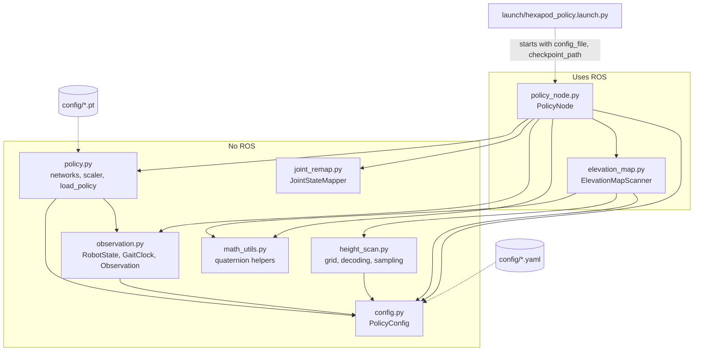
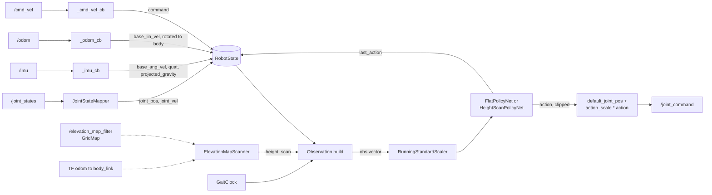
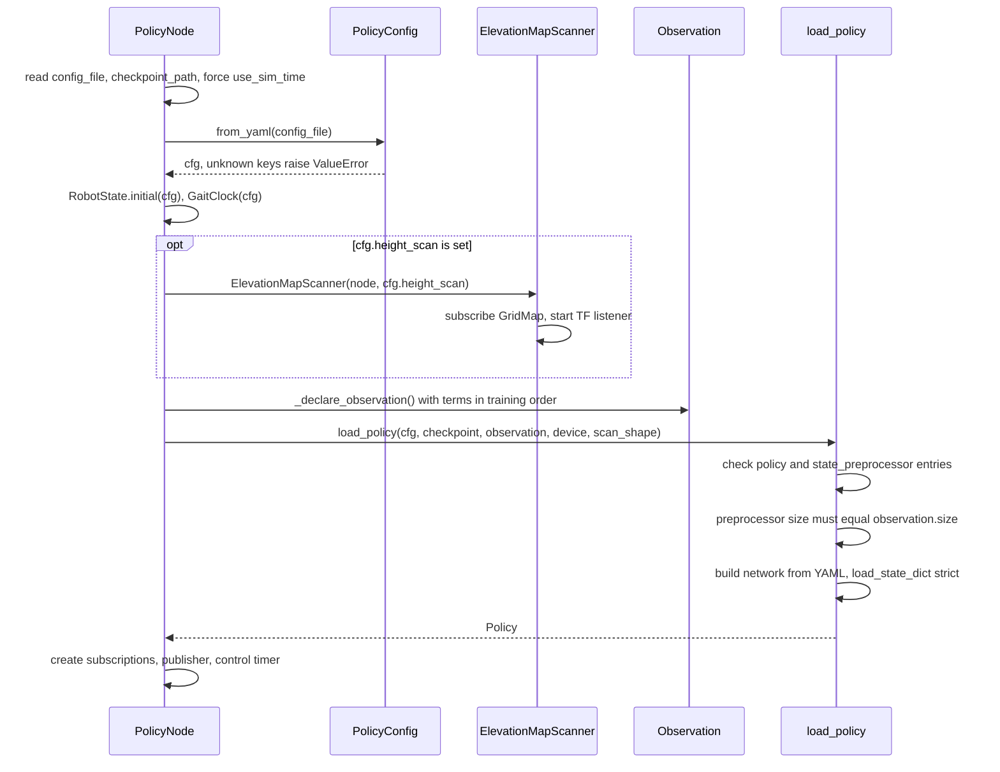
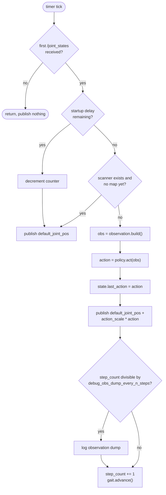

# elkapod_rl_deploy architecture

How the policy node is put together: module imports, startup, the control loop and the observation layout for the flat and rough policies.

## Module dependencies

Arrows point from the importing module to the imported one. Only `policy_node` and `elevation_map` touch ROS. `height_scan`, `observation` and `policy` can be tested without it.

## Runtime data flow

Subscriber callbacks only write into `RobotState` (and the scanner's map). The 50 Hz timer reads everything, runs the network and publishes. The dashed path exists only when the YAML has a `height_scan` section.

## Startup sequence

`PolicyNode.__init__` runs top to bottom. Every consistency check happens here, so a wrong config or checkpoint stops the node before it subscribes to anything.

## Control step

One call of `_control_step` per timer tick. Nothing is published until the first `/joint_states` message arrives. After that, the robot holds the default pose during the startup delay and while the rough policy waits for its first map.

